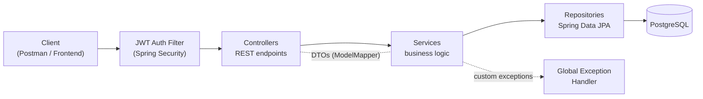
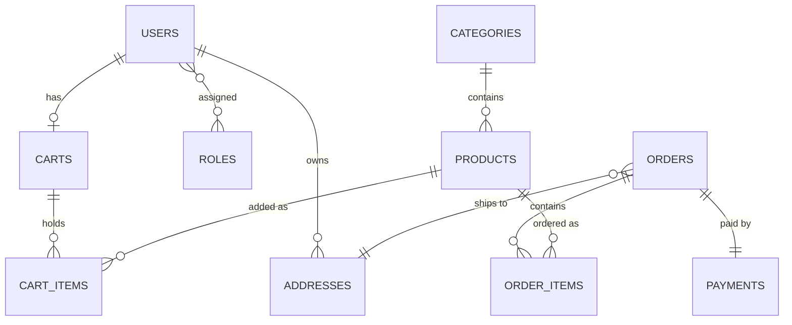

<div align="center">

# 🌱 Spring Boot Learning Journey

**From Spring Core fundamentals to a secured eCommerce REST API with JWT and PostgreSQL**


</div>

---

## 📖 About

This repository is a **step-by-step record of how I learned Java backend development with Spring**. It has **22 numbered, runnable projects**. Each one adds a single concept on top of the previous one, and has its own README with the explanation, code highlights and run steps.

The learning path has two parts:

1. **Spring Core (01-13):** Inversion of Control, Dependency Injection and bean configuration.
2. **Spring Boot eCommerce API (14-22):** one project that grows from "Hello World" into a secured REST API with a cart, addresses and orders.

> 👀 **In a hurry?** Open [`22-cart-address-order-postgres`](22-cart-address-order-postgres). It is the most complete project and contains everything built before it.

---

## 🧰 Skills Demonstrated

| Area | What I used |
|------|-------------|
| **Language** | Java 17/21, OOP, interfaces, generics, streams |
| **Spring Core** | IoC container, DI (constructor, setter, field), autowiring, `@Component`, `@Qualifier`, `@Value`, XML and Java config |
| **REST APIs** | `@RestController`, CRUD endpoints, path variables, request bodies, `ResponseEntity`, correct HTTP status codes |
| **Data** | Spring Data JPA, Hibernate, derived queries, pagination and sorting, H2 and PostgreSQL |
| **Relationships** | `@OneToOne`, `@OneToMany`, `@ManyToOne`, `@ManyToMany`, cascading, `orphanRemoval` |
| **Clean architecture** | Controller, Service, Repository layers; DTO pattern with ModelMapper |
| **Validation and errors** | Bean Validation, custom exceptions, `@RestControllerAdvice` global handler |
| **Security** | Spring Security 6, JWT in cookies, BCrypt, stateless auth, custom filter, roles |
| **Features** | Search, file upload, shopping cart, orders, payment records, transactions |
| **Tools** | Maven, Postman, Docker Compose, IntelliJ IDEA, Git and GitHub |

---

## 🗺️ Learning Path

### Part 1 · Spring Core Fundamentals

| # | Project | What it teaches |
|:-:|---------|-----------------|
| 01 | [tight-and-loose-coupling](01-tight-and-loose-coupling) | Why coupling matters, and the problem IoC solves |
| 02 | [creating-first-bean](02-creating-first-bean) | Defining and retrieving a Spring bean |
| 03 | [constructor-injection](03-constructor-injection) | Constructor-based dependency injection |
| 04 | [setter-injection](04-setter-injection) | Setter-based dependency injection |
| 05 | [ioc-challenge](05-ioc-challenge) | Applying IoC to a loosely coupled design |
| 06 | [autowiring-by-name](06-autowiring-by-name) | Autowiring by bean name |
| 07 | [autowiring-by-type](07-autowiring-by-type) | Autowiring by bean type |
| 08 | [autowiring-by-constructor](08-autowiring-by-constructor) | Autowiring through the constructor |
| 09 | [component-scan](09-component-scan) | Automatic bean discovery |
| 10 | [value-annotation](10-value-annotation) | Injecting values with `@Value` and SpEL |
| 11 | [xml-to-annotations](11-xml-to-annotations) | Moving from XML to Java and annotation config |
| 12 | [autowired-annotation](12-autowired-annotation) | `@Autowired` in practice |
| 13 | [qualifier-annotation](13-qualifier-annotation) | Resolving ambiguity with `@Qualifier` |

### Part 2 · Spring Boot REST API (eCommerce)

| # | Project | What I built |
|:-:|---------|--------------|
| 14 | [first-spring-boot-rest-api](14-first-spring-boot-rest-api) | First Spring Boot app and REST controller |
| 15 | [ecommerce-project](15-ecommerce-project) | Category CRUD with a layered architecture |
| 16 | [ecommerce-jpa-h2](16-ecommerce-jpa-h2) | Persistence with Spring Data JPA and H2 |
| 17 | [ecommerce-validation-exceptions](17-ecommerce-validation-exceptions) | Input validation and global exception handling |
| 18 | [ecommerce-dto-pagination](18-ecommerce-dto-pagination) | DTO pattern, pagination and sorting |
| 19 | [jpa-relationships-and-cascading](19-jpa-relationships-and-cascading) | Entity relationships and cascade types |
| 20 | [ecommerce-products-and-images](20-ecommerce-products-and-images) | Products, keyword search and image upload |
| 21 | [spring-security-jwt-auth](21-spring-security-jwt-auth) | Sign up, sign in and sign out with JWT |
| 22 | [cart-address-order-postgres](22-cart-address-order-postgres) | Cart, addresses, orders and payments on PostgreSQL |

---

## 🏗️ Architecture of the Final Project



### Database Design



---

## 🔌 API Overview (project 22)

| Module | Endpoints |
|--------|-----------|
| **Auth** | `POST /api/auth/signup` · `POST /api/auth/signin` · `POST /api/auth/signout` · `GET /api/auth/user` |
| **Categories** | `GET` `POST` `PUT` `DELETE` under `/api/public/categories`, `/api/admin/categories` |
| **Products** | list with pagination, filter by category, keyword search, update, delete, image upload |
| **Addresses** | `POST` `GET` `PUT` `DELETE` under `/api/addresses`, plus `/api/users/addresses` |
| **Cart** | add product, view cart, increase or decrease quantity, remove product |
| **Orders** | `POST /api/order/users/payments/{paymentMethod}` |

Full request and response examples are in each project's README.

---

## 🚀 Quick Start

**Requirements:** JDK 17+, Maven, and Docker (only for project 22).

```bash
# 1. Clone
git clone https://github.com/SindhujaReddy-BIS/spring-boot-learning-journey.git
cd spring-boot-learning-journey

# 2. Run any of projects 14-21 (in-memory H2 database, no setup)
cd 20-ecommerce-products-and-images
./mvnw spring-boot:run          # Windows: mvnw.cmd spring-boot:run
```

To run the final project (22) with PostgreSQL:

```bash
cd 22-cart-address-order-postgres
export DB_PASSWORD=yourpassword      # Windows: set DB_PASSWORD=yourpassword
docker compose up -d                 # starts PostgreSQL
./mvnw spring-boot:run
```

Then open Postman and follow the steps in the project's README. Demo logins (H2 or local only): `admin / adminPass`, `user1 / password1`.

> Secrets such as the database password and JWT secret are read from **environment variables**. No real credentials are stored in this repository.

---

## 🔭 Roadmap

- [ ] Role-based access rules (`ADMIN`, `SELLER`, `USER`) on endpoints
- [ ] Unit and integration tests with JUnit 5 and Mockito
- [ ] Payment gateway integration
- [ ] Swagger / OpenAPI documentation
- [ ] Dockerize the application and add a GitHub Actions CI pipeline
- [ ] Deployment to the cloud

---

## 📂 Repository Structure

```
spring-boot-learning-journey/
├── 01 … 13   Spring Core: IoC, DI, autowiring, bean configuration
├── 14 … 20   Spring Boot REST API, JPA, validation, DTOs, relationships
├── 21        Spring Security with JWT
├── 22        Cart, addresses, orders, PostgreSQL
├── LICENSE
└── README.md
```

Each folder is a standalone Maven project with its own `README.md`.

---

## 👩‍💻 Author

**Sindhuja Reddy** · Aspiring Java Backend Developer

[](https://github.com/SindhujaReddy-BIS)

*These projects were built while following a Spring Boot course, as hands-on practice. Each folder holds my own code and notes.*

⭐ If you find this useful, feel free to star the repository.
